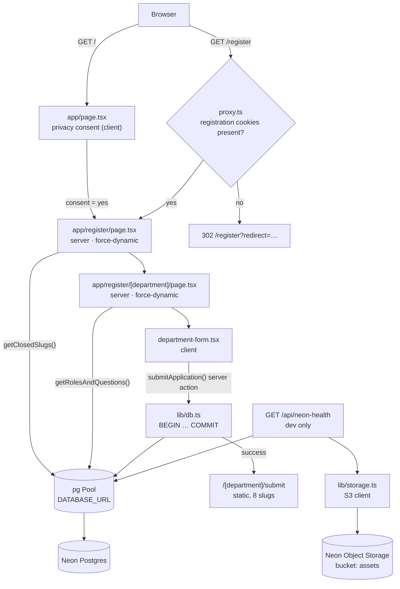

# 01 — Overview

## Purpose

This repository is the **CyberPH membership registration form**. It collects applications
from students who want to join CyberPH, either as a general member or by applying for a
leadership/committee position inside one of eight departments.

Two things make it more than a static form:

1. **The org chart is database-driven.** Departments have roles; roles have screening
   questions. Admins edit rows in Postgres and the live form changes on the next request.
2. **Departments can be closed.** A `departments.closed` flag is toggled live and is checked
   on the department select, on the department page, and again inside the submit
   transaction.

An applicant's answers are **not** written to the database until the final Submit. Until
then they live in browser cookies.

## Feature list

- Privacy-consent gate before any data is collected.
- Eleven-field personal information form with per-field, on-blur Zod validation.
- Personal details persisted in cookies (30 days) so going back/forward does not lose them.
- Department selection that reflects live open/closed state.
- Position selection per department, with 2 screening questions per position (seeded).
- A single atomic server action that writes personal info, one application, and all answers,
  or nothing.
- Duplicate-application protection: one application per email address (case-insensitive).
- Branded UI: CyberPH header/footer banners, logo watermark, tri-colour rule, smooth scroll.
- Dev-only health endpoint that round-trips Postgres and Object Storage.

## Stack

| Concern | Choice | Version |
| ------- | ------ | ------- |
| Framework | Next.js App Router | `^16.4.5` |
| UI runtime | React / React DOM | `19.2.3` |
| Styling | Tailwind CSS (CSS-first config) + PostCSS plugin | `^4` |
| Smooth scroll | Lenis | `^1.3.18` |
| Schema validation | Zod | `^4.3.6` |
| Database driver | `pg` | `^8.23.1` |
| Object storage client | `@aws-sdk/client-s3` | `^3.1165.0` |
| Neon service config | `@neon/config` | `^1.14.0` |
| Neon env helpers | `@neon/env` | `^2.1.3` (installed, not imported) |
| Neon realtime client | `@neon/realtime` | `^0.2.1` (installed, not imported) |
| WebSocket lib | `ws` | `^8.22.2` (installed, not imported) |
| Linting | ESLint flat config + `eslint-config-next` | `^9` / `^16.4.5` |
| TypeScript | `tsc` | `^5`, `strict: true` |

`@neon/env`, `@neon/realtime`, and `ws` are present in `package.json` but never imported by
application code. Realtime is declared in `neon.ts` yet deliberately unused — see
[Architecture](./03-architecture.md#realtime-is-enabled-but-unused).

## Architecture at a glance



Reads and writes both go through one pooled `pg` client (`lib/pg.ts`). Migrations use the
**unpooled** connection instead (`scripts/migrate.mjs`), per Neon's guidance.

## Repository layout

```text
cph-membership-forms/
├─ app/
│  ├─ api/neon-health/route.ts     dev-only end-to-end health check
│  ├─ register/
│  │  ├─ [department]/
│  │  │  ├─ department-form.tsx    client: role picker + questions + submit
│  │  │  ├─ page.tsx               server: loads live roles/questions
│  │  │  └─ submit/page.tsx        static confirmation page (8 slugs)
│  │  ├─ departments.ts            canonical department list (slug/name/description)
│  │  ├─ page.tsx                  server: passes closed slugs to the form
│  │  ├─ personal-info.ts          Zod schema + cookie names + row mapping (shared)
│  │  ├─ register-form.tsx         client: personal info form, cookie persistence
│  │  └─ submission-confirmation.tsx client: reads ?role= from the URL
│  ├─ globals.css                  Tailwind import, theme tokens, banner CSS
│  ├─ icon.png                     favicon
│  ├─ layout.tsx                   root layout, fonts, metadata, Lenis provider
│  ├─ lenis-provider.tsx           client: smooth scrolling
│  └─ page.tsx                     privacy consent landing page
├─ db/schema.sql                   tables, view, seeds, RLS (idempotent)
├─ docs/                           this documentation
├─ lib/
│  ├─ db.ts                        the only write path: submitApplication
│  ├─ pg.ts                        memoised connection pool
│  ├─ proxy.ts                     cookie guard used by proxy.ts
│  ├─ questions.ts                 live reads: closed departments, roles, questions
│  └─ storage.ts                   S3 client + bucket name
├─ public/cyberph/                 banner images (1x/2x) and logo
├─ scripts/migrate.mjs             applies db/schema.sql over the direct URL
├─ neon.ts                         Neon service/bucket/branch declaration
├─ next.config.ts                  empty Next config
├─ proxy.ts                        request guard for /register/*
├─ postcss.config.mjs              Tailwind PostCSS plugin
├─ eslint.config.mjs               flat ESLint config
├─ tsconfig.json                   strict TS, `@/*` alias
├─ AGENTS.md                       agent rules injected by `next dev`
└─ README.md                       upstream Next.js boilerplate + backend notes
```

## npm scripts

| Script | Command | Use |
| ------ | ------- | --- |
| `npm run dev` | `next dev` | Local development (writes `AGENTS.md` and dev types) |
| `npm run build` | `next build` | Production build; prerenders the 8 confirmation pages |
| `npm start` | `next start` | Serve the production build |
| `npm run lint` | `eslint` | Flat-config ESLint over the repo |
| `npm run db:migrate` | `node scripts/migrate.mjs` | Apply `db/schema.sql` over `DATABASE_URL_UNPOOLED` |

## Related docs

- [Getting started](./02-getting-started.md) — run it locally
- [Architecture](./03-architecture.md) — rendering, boundaries, proxy
- [Data model](./06-data-model.md) — tables and seeds
