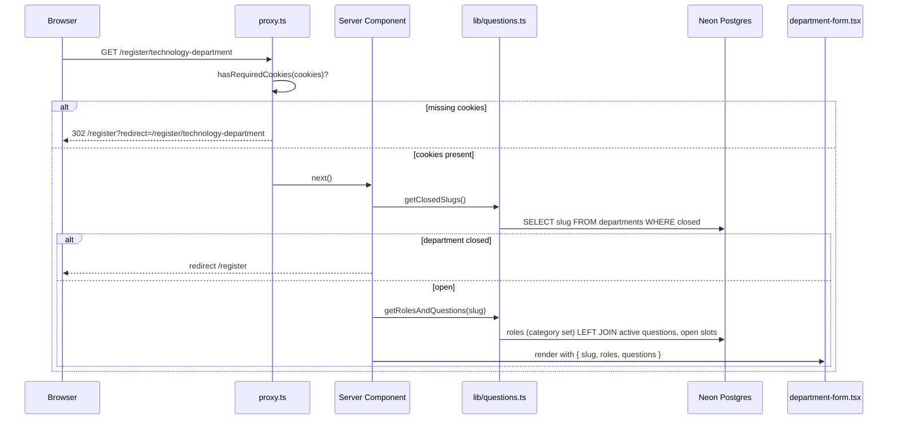
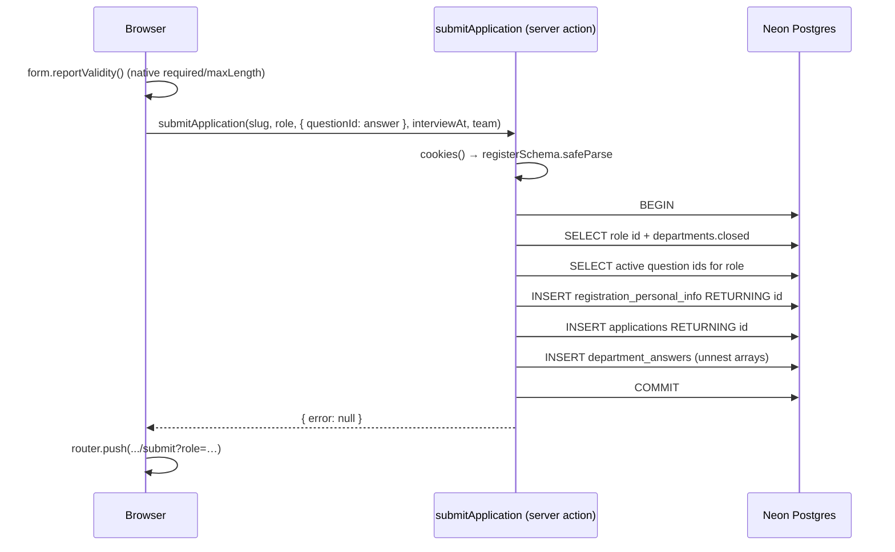

# 03 — Architecture

## Shape of the app

A single Next.js App Router application with no separate backend service. All server work
happens in three places:

1. **Server Components** (`app/**/page.tsx`) — read live data for rendering.
2. **A server action** (`lib/db.ts`) — the only write path.
3. **A route handler** (`app/api/neon-health/route.ts`) — dev-only diagnostics.

There is no authentication, no user session, no caching layer, and no client-side data
fetching. The browser talks to the server twice: once for each page, once for the submit
action.

## Rendering modes

| Route | File | Mode | Reason |
| ----- | ---- | ---- | ------ |
| `/` | `app/page.tsx` | Static, client-rendered | No data; consent is local state |
| `/register` | `app/register/page.tsx` | **Dynamic** (`force-dynamic`) | Reads `departments.closed` on every request |
| `/register/[department]` | `app/register/[department]/page.tsx` | **Dynamic** (`force-dynamic`) | Reads roles and active questions on every request |
| `/register/[department]/submit` | `app/register/[department]/submit/page.tsx` | **Static**, 8 params, `dynamicParams = false` | Pure confirmation copy; no data |
| `/api/neon-health` | `app/api/neon-health/route.ts` | **Dynamic** (`force-dynamic`) | Live probes |

The two `force-dynamic` declarations are the mechanism that makes admin edits appear "live".
Anything that caches those pages would break the promise in `README.md` that the form reads
roles and questions on every page load.

The confirmation route uses:

```ts
export const dynamicParams = false;
export const generateStaticParams = () => DEPARTMENTS.map((d) => ({ department: d.slug }));
```

so only the eight slugs in `app/register/departments.ts` are valid; anything else 404s at
build time. If you add a department to `DEPARTMENTS`, it is automatically prerendered.

## Proxy (formerly middleware)

Next.js 16 **deprecated the `middleware` file convention and renamed it to `proxy`**. This
repo uses the new convention:

- Root file: `proxy.ts` (not `middleware.ts`).
- Named export: `proxy(request: NextRequest)`.
- Runtime: Node.js. The Edge runtime is **not** supported in `proxy`, and cannot be
  configured.
- Matcher: `export const config = { matcher: ["/register/:path*"] }`.

```ts
export function proxy(request: NextRequest) {
  const { pathname } = request.nextUrl;

  if (pathname === "/register" || pathname === "/register/") {
    return NextResponse.next();
  }

  if (!registrationGuard.hasRequiredCookies(request.cookies)) {
    const redirectUrl = request.nextUrl.clone();
    redirectUrl.pathname = "/register";
    redirectUrl.searchParams.set("redirect", pathname);
    return NextResponse.redirect(redirectUrl);
  }

  return NextResponse.next();
}
```

### What the guard actually checks

`lib/proxy.ts` owns the contract:

```ts
const REQUIRED_REGISTRATION_COOKIES = [
  "registration_firstName",
  "registration_lastName",
  "registration_email",
  "registration_facebookLink",
  "registration_discordUsername",
  "registration_collegeCampus",
  "registration_membershipType",
];
```

A cookie passes if its trimmed value is non-empty. The guard is a **navigation convenience,
not a security boundary**: cookies are client-writable and the real validation happens
server-side in `submitApplication`. See
[Validation and security](./08-validation-and-security.md#the-cookie-model).

> **Known limitation:** the guard omits `registration_facebookSharedPost`. An applicant can
> therefore navigate to a department page with a missing shared-post cookie; the submit
> action then rejects the application because `registerSchema` requires that field. The
> failure is safe but the UX is a late error rather than a redirect. Adding the cookie to
> `REQUIRED_REGISTRATION_COOKIES` would make the two lists agree.

> **Note on imports:** the Next.js docs advise that proxy should not rely on shared modules
> because it may be deployed to a CDN boundary. Here `proxy.ts` imports `registrationGuard`
> from `@/lib/proxy`. That is fine for this single-server deployment, but be aware of the
> constraint if the app is ever fronted by a separate proxy/CDN layer.

## Server ↔ client boundary

| Module | Directive | Runs where | Notes |
| ------ | --------- | ---------- | ----- |
| `app/layout.tsx` | server component | server | Fonts, metadata, wraps children in `LenisProvider` |
| `app/page.tsx` | `"use client"` | browser | Consent radios, `useRouter` |
| `app/register/page.tsx` | server component | server | Awaits `getClosedSlugs()`, passes plain array |
| `app/register/register-form.tsx` | `"use client"` | browser | Zod validation, `document.cookie` writes, navigation |
| `app/register/personal-info.ts` | plain module | **both** | Schema + record mapping; imported by client form and server action |
| `app/register/departments.ts` | plain module | **both** | Static department metadata, imported by client and server code |
| `app/register/[department]/page.tsx` | server component | server | `notFound()`, `redirect()`, live queries |
| `app/register/[department]/department-form.tsx` | `"use client"` | browser | Calls the server action |
| `app/register/submission-confirmation.tsx` | `"use client"` | browser | Reads `?role=` via `useSearchParams` |
| `lib/db.ts` | `"use server"` | server | Every export becomes a server action |
| `lib/pg.ts`, `lib/storage.ts` | `server-only` | server | Importing from client code fails the build |
| `lib/questions.ts` | plain module | server | Imported only by server pages |

Two boundary details matter when editing:

- `department-form.tsx` takes a **slug**, not a `Department` object, because only
  serialisable plain data may cross the boundary (comment in the file: "Takes the slug, not
  the config object, so only plain data crosses the server/client boundary").
- `department-form.tsx` imports `submitApplication` from a `"use server"` module directly.
  Next.js replaces that import with an action reference; do not move the action into a
  client-side fetch wrapper.

## Request lifecycle

### Loading the department page



### Submitting



Every early return inside the transaction calls a local `fail()` helper that issues
`ROLLBACK` and returns `{ error }`. The `finally` block always releases the client back to
the pool.

## Data access rules

- **Reads:** `lib/questions.ts` only. Two queries: closed slugs, and roles+questions for one
  department. Both use parameterised SQL and the shared pool.
- **Writes:** `lib/db.ts` only. No other module issues `INSERT`/`UPDATE`/`DELETE`.
- **Migrations:** `scripts/migrate.mjs` only, over `DATABASE_URL_UNPOOLED`.
- **Object Storage:** `lib/storage.ts` is used only by the health route. Applicants do not
  upload files; they paste a Google Drive link into `certificateLink`.

## Connection pooling

`lib/pg.ts` keeps one pool per server process and rebuilds it when `DATABASE_URL` changes:

```ts
const globalForPg = globalThis as unknown as { pgPool?: Pool; pgUrl?: string };
const url = process.env.DATABASE_URL;
if (!globalForPg.pgPool || globalForPg.pgUrl !== url) {
  void globalForPg.pgPool?.end().catch(() => {});
  globalForPg.pgPool = new Pool({ connectionString: url });
  globalForPg.pgUrl = url;
}
export const pool = globalForPg.pgPool;
```

Why the `globalThis` dance: Next.js hot reload re-evaluates modules, and without the global
cache you would leak a pool per edit. Deleting the old pool when the URL changes means
`neon env pull` mid-session does not require a restart.

The source contains a shortcut comment worth keeping in mind if this is ever deployed to
Vercel: wrap the pool with `attachDatabasePool` from `@vercel/functions` so idle clients
close before the function suspends.

## Realtime is enabled but unused

`neon.ts` sets `preview: { realtime: true }` and `neon env pull` writes
`NEON_REALTIME_URL` / `NEON_REALTIME_SECRET`, but no code imports `@neon/realtime` or
`ws`. The reason is recorded in the health route and `README.md`:

> Neon Realtime rejects tables with RLS on, and every table here has RLS.

So realtime would need at least one table without RLS (or a different authorisation model)
before it could be used. The health route deliberately has no realtime check.

## Failure handling

| Layer | Behaviour |
| ----- | --------- |
| Proxy | Redirects to `/register` with `?redirect=`; the personal-info form shows an amber banner when that param is present |
| Department page | `notFound()` for unknown slugs; `redirect("/register")` when closed |
| Personal-info form | Collects Zod issues per field; no network call until the department submit |
| Server action | Returns `{ error: string }` for expected problems; logs unexpected errors with `console.error("[submitApplication] <slug>", err)`; duplicate email is translated by constraint name |
| Health route | Per-service `{ ok, error }`; HTTP 200 only if every check passed |
