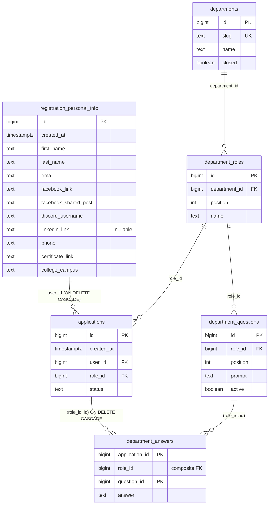

# 06 — Data model

`db/schema.sql` is the source of truth. It is applied with `npm run db:migrate` and is
idempotent, so it doubles as the migration file. There is no separate migration framework and
no `drizzle`/`prisma` layer — SQL is hand-written and typed by hand in `lib/db.ts`.

## Entity relationship



Reading the diagram: a **user** (applicant) has one or more **applications**; each application
targets one **role**, which belongs to one **department**; each role owns **questions**; an
**answer** ties one application to one question.

## Tables

### `registration_personal_info`

The applicant. Written once, on the final Submit, in the same transaction as the application.

| Column | Type | Null | Default | Notes |
| ------ | ---- | ---- | ------- | ----- |
| `id` | `bigint` | no | identity | PK |
| `created_at` | `timestamptz` | no | `now()` | |
| `first_name` | `text` | no | | |
| `last_name` | `text` | no | | |
| `email` | `text` | no | | Case-insensitively unique (see indexes) |
| `facebook_link` | `text` | no | | Validated as a `facebook.com` URL |
| `facebook_shared_post` | `text` | no | | Validated as a `facebook.com` URL |
| `discord_username` | `text` | no | | |
| `linkedin_link` | `text` | **yes** | | `NULL` when the optional field is blank |
| `pup_webmail` | `text` | **yes** | | **Legacy.** No longer asked; `DROP NOT NULL` kept for older rows |
| `phone` | `text` | no | | `09xxxxxxxxx` |
| `course_year_section` | `text` | **yes** | | **Legacy.** No longer asked |
| `certificate_link` | `text` | no | | Google Drive link to a valid ID (older rows: COR) |
| `college_campus` | `text` | no | | |

Indexes:

```sql
CREATE UNIQUE INDEX IF NOT EXISTS registration_personal_info_email_key
  ON registration_personal_info (lower(email));
```

This is what enforces "one application per person". It is a **functional unique index**, so
`Juan@x.com` and `juan@x.com` collide. `lib/db.ts` translates the violation (constraint name
`registration_personal_info_email_key`) into a friendly error.

The table has **no** `updated_at`, no soft-delete, and no consent column.

### `departments`

| Column | Type | Null | Default | Notes |
| ------ | ---- | ---- | ------- | ----- |
| `id` | `bigint` | no | identity | PK |
| `slug` | `text` | no | | UNIQUE; must match a slug in `app/register/departments.ts` |
| `name` | `text` | no | | Display name |
| `closed` | `boolean` | no | `false` | Toggled by the admin; closed departments take no applications |

The `slug` is the join key between the database and the hard-coded department metadata. The
app never reads `departments.name` for display — it uses `DEPARTMENTS[].name` — so renaming a
department in SQL will **not** change the UI (and can break the name → slug lookup in
`register-form.tsx`). Rename in `departments.ts` first, then in SQL.

A one-time backfill block closes four departments on databases created before `closed`
existed:

```sql
DO $$
BEGIN
  IF NOT EXISTS (
    SELECT 1 FROM information_schema.columns
    WHERE table_name = 'departments' AND column_name = 'closed'
  ) THEN
    ALTER TABLE departments ADD COLUMN closed boolean NOT NULL DEFAULT false;
    UPDATE departments SET closed = true
    WHERE slug IN ('administrative-department', 'creatives-department',
                   'operations-department', 'technology-department');
  END IF;
END $$;
```

> **Behaviour to know:** on a **fresh** database `CREATE TABLE` already creates `closed`, so
> the `IF` is false and **no department is closed**. The four closed defaults only appear when
> upgrading an old database. Do not assume a fresh install matches production.

### `department_roles`

| Column | Type | Null | Default | Notes |
| ------ | ---- | ---- | ------- | ----- |
| `id` | `bigint` | no | identity | PK |
| `department_id` | `bigint` | no | | FK → `departments(id)` |
| `position` | `int` | no | `1` | Display order within the department |
| `name` | `text` | no | | UNIQUE per department |
| `category` | `text` | **yes** | | `Executive`, `Lead`, `Committee Member`, or `Member` (CHECK); groups the role on the form. `NULL` = retired, hidden |
| `interview` | `boolean` | no | `true` | `false` skips the interview scheduler (General Member, Creatives Floor Committee) |
| `teams` | `text[]` | **yes** | | Teams to pick from after choosing the role. `Group / Team` entries are grouped on the form |

Constraint: `UNIQUE (department_id, name)`.

The role **name** is the value posted by the department form and matched again in the server
action (`WHERE d.slug = $1 AND r.name = $2`). Renaming a role is therefore safe for existing
applications (they reference `role_id`), but an applicant mid-form will get "The questions were
just updated…" or "Please select a position before submitting."

### `department_questions`

| Column | Type | Null | Default | Notes |
| ------ | ---- | ---- | ------- | ----- |
| `id` | `bigint` | no | identity | PK |
| `role_id` | `bigint` | no | | FK → `department_roles(id)` |
| `position` | `int` | no | `1` | Display order within the role |
| `prompt` | `text` | no | | `CHECK (prompt <> '')` |
| `active` | `boolean` | no | `true` | Only active questions render and are required |

Constraint: `UNIQUE (role_id, id)` — technically redundant (the PK already identifies a row)
but required as the **target of a composite foreign key** from `department_answers`, and it
also gives an index on `role_id`.

The schema comment states the intended editing model:

> To change a question's meaning, set `active = false` and add a new row, so old answers keep
> the question they answered. Questions with answers can't be deleted.

Questions are never deleted by the app. Deactivation hides them from the form and from
`getRolesAndQuestions`, while existing answers keep a valid FK.

### `applications`

| Column | Type | Null | Default | Notes |
| ------ | ---- | ---- | ------- | ----- |
| `id` | `bigint` | no | identity | PK |
| `created_at` | `timestamptz` | no | `now()` | |
| `user_id` | `bigint` | no | | FK → `registration_personal_info(id) ON DELETE CASCADE` |
| `role_id` | `bigint` | no | | FK → `department_roles(id)`; the role implies the department |
| `status` | `text` | no | `'pending'` | Interview tracking; free text, **no CHECK constraint** |
| `interview_at` | `timestamptz` | **yes** | | Start of the booked 20-minute slot. `NULL` for members and departments without windows |
| `team` | `text` | **yes** | | The team picked, for roles with `teams`; otherwise `NULL` |
| `reschedule_token` | `text` | **yes** | | Random secret also kept in the applicant's `cph_application` cookie; lets them move `interview_at` for 5 hours |

Constraints and indexes:

- `UNIQUE (role_id, id)` — the target of the answers' composite FK.
- `CREATE INDEX applications_user_id_idx ON applications (user_id)` — makes "all applications
  for a user" and the cascade delete fast.

Because `user_id` cascades, deleting an applicant removes their applications, which in turn
cascades to their answers (see below). This is the only supported way to "reset" an email so
it can apply again.

### `interview_windows`

| Column | Type | Null | Notes |
| ------ | ---- | ---- | ----- |
| `id` | `bigint` | no | PK |
| `department_id` | `bigint` | no | FK → `departments(id)` |
| `starts_at` | `timestamptz` | no | |
| `ends_at` | `timestamptz` | no | `CHECK (ends_at > starts_at)` |

Interview availability, added by the admin (see "Add interview availability"). The form cuts
each window into 20-minute slots. One applicant per slot per department is enforced by the
submit transaction, not by a constraint.

### `department_answers`

| Column | Type | Null | Notes |
| ------ | ---- | ---- | ----- |
| `application_id` | `bigint` | no | Part of PK; part of the applications FK |
| `role_id` | `bigint` | no | Part of **both** composite FKs; not part of the PK |
| `question_id` | `bigint` | no | Part of PK; part of the questions FK |
| `answer` | `text` | no | `CHECK (char_length(answer) BETWEEN 1 AND 5000)` |

```sql
PRIMARY KEY (application_id, question_id),
FOREIGN KEY (role_id, application_id) REFERENCES applications (role_id, id) ON DELETE CASCADE,
FOREIGN KEY (role_id, question_id)  REFERENCES department_questions (role_id, id)
```

**Why `role_id` is duplicated here.** It is the trick that makes the database enforce
cross-table consistency: an answer's question must belong to the same role as the application.
A plain `question_id` FK would allow answering another role's (or department's) question. The
schema comment says exactly this.

Consequences to remember:

- One answer per question per application (PK).
- Answers are immutable in practice — the app never updates them; a re-submit is blocked by
  the email index.
- Deleting the application cascades the answers.
- Deleting a question that has answers is rejected by the implicit `NO ACTION` FK.
- The 5000-character cap exists in three places: this CHECK, the `<textarea maxLength>`, and
  the server-side check in `submitApplication`.

## The `application_answers` view

```sql
CREATE OR REPLACE VIEW application_answers WITH (security_invoker = true) AS
SELECT a.id AS application_id, a.created_at, a.status,
       p.id AS user_id, p.first_name, p.last_name, p.email,
       d.id AS department_id, d.name AS department,
       r.name AS role,
       q.id AS question_id, q.prompt AS question, x.answer,
       a.interview_at, a.team
FROM department_answers x
JOIN applications a ON a.id = x.application_id
JOIN registration_personal_info p ON p.id = a.user_id
JOIN department_roles r ON r.id = a.role_id
JOIN departments d ON d.id = r.department_id
JOIN department_questions q ON q.id = x.question_id;
```

- One row per answer, fully joined — the readable shape for the admin.
- `security_invoker = true` means the view runs with the caller's permissions, so RLS on the
  base tables still applies. Without it the view would be a privilege-escalation back door.
- Because it is an inner join chain, an application with **zero** answers does not appear in
  the view at all (**known limitation**). Use `applications` to list applications, then the
  view for answers.

Typical read:

```sql
SELECT first_name, last_name, email, department, role, status, question, answer
FROM application_answers
ORDER BY created_at DESC, application_id, question_id;
```

## Seeding

The seed block inserts, in order:

1. **9 departments** (including `member` / General Member) — `ON CONFLICT (slug) DO NOTHING`, so it is safe on every run.
2. **44 roles**, each with a `category`: one `Executive` (Associate Vice President) per
   department except Administration, the committee `Lead`s, `Committee Member` roles (one per
   committee, most with `teams`), and one `Member` role. VPs are already appointed,
   so there is no VP role.
   Guarded by `WHERE NOT EXISTS (SELECT 1 FROM department_roles)` — it only runs while the
   table is **empty**.
3. **190 questions** — 3 to 7 per role (none for `Member`), guarded the same way
   (`WHERE NOT EXISTS (SELECT 1 FROM department_questions)`).

Rows are staged in a session-local temp table `seed` that is dropped at the end.

> **Important for new departments:** the roles/questions seeds only fire when their tables are
> completely empty. If you add a ninth department to `DEPARTMENTS` and to `departments`, the
> migration will **not** create roles for it — insert them manually.

| Department slug | Roles | Questions |
| --------------- | ----- | --------- |
| `administrative-department` | Secretary; Treasurer & Auditor | 4 |
| `people-and-culture-department` (Community Development) | AVP; Talent Development, Human Resource, Community Expansion Team Lead / Co-Lead | 16 |
| `business-development-department` | AVP; Partnership Lead; Sponsorship Lead | 12 |
| `creatives-department` | AVP; Floor Committee Lead (Documentation, On-site Decor); Creation Committee Lead (Visual, Media Production) | 20 |
| `marketing-department` | AVP; Marketing Operations Lead; Marketing Strategy Lead | 18 |
| `operations-department` | AVP; Event Operations, Event Planning, Product and Development Committee Lead | 16 |
| `strategic-planning-department` | AVP; Strategic Insights, Program Development Lead / Co-Lead | 15 |
| `technology-department` | AVP; Technology and Engineering Lead | 9 |

Production was moved to this set on 2026-11-19 by hand (the seed doesn't re-run). The old
"Treasurer & Auditor" role is still there, hidden by `category = NULL`; delete it once nothing
points at it. Interview windows are not seeded; production's were inserted by hand.

## Row Level Security

The last block of `schema.sql` enables RLS on every table in `public`, with **no policies**:

```sql
DO $$
DECLARE t text;
BEGIN
  FOR t IN SELECT tablename FROM pg_tables WHERE schemaname = 'public' LOOP
    EXECUTE format('ALTER TABLE %I ENABLE ROW LEVEL SECURITY', t);
  END LOOP;
END $$;
```

Effect:

- The table **owner** (`neondb_owner`, which has `BYPASSRLS`) — used by the app server and by
  the admin in the Neon console — reads and writes normally.
- Any other role (for example Data API's `anonymous` / `authenticated`) sees **zero rows** and
  cannot insert.
- The view inherits the caller's rights thanks to `security_invoker = true`.

This is "locked by default": if you ever add a Data API client or a second database role, you
must add explicit policies. Adding a new table later does **not** automatically get RLS — the
loop only runs when the migration runs, and it does cover new tables on the next run.

## Admin recipes

All statements run in the Neon console SQL editor (or `psql` over the direct connection) as
the owner role. There is no admin UI in this repo; `cph-admin` is the name used in the source
comments for the external admin workflow.

### Close or open a department

```sql
-- close
UPDATE departments SET closed = true  WHERE slug = 'technology-department';
-- open
UPDATE departments SET closed = false WHERE slug = 'technology-department';
```

Takes effect on the next page load (`force-dynamic`). The select option becomes disabled, and
the department URL redirects to `/register`. In-flight submissions fail with "This department
is not accepting applications."

### Add a role

```sql
INSERT INTO department_roles (department_id, position, name)
SELECT id, 3, 'Committee Head'
FROM departments
WHERE slug = 'technology-department';
```

Then add questions for it. Position controls ordering; ties break by `id`.

### Replace a question without losing history

```sql
-- 1. retire the old one
UPDATE department_questions SET active = false WHERE id = 42;

-- 2. add the replacement in the same slot
INSERT INTO department_questions (role_id, position, prompt)
SELECT role_id, position, 'New prompt text?'
FROM department_questions WHERE id = 42;
```

Old answers keep pointing at question 42, so exports remain truthful. Applicants who had the
page open will hit "The questions were just updated. Please reload the page and answer them
again." — that is the intended protection.

### Retire a role

```sql
UPDATE department_roles SET category = NULL WHERE id = 7;
```

A role with no category disappears from the form and can't be submitted, but its applications
and answers stay readable. Valid categories: `Executive`, `Lead`, `Committee Member`, `Member`.

### Add interview availability

```sql
INSERT INTO interview_windows (department_id, starts_at, ends_at)
SELECT id, '2026-11-26 19:00+08', '2026-11-26 21:00+08'
FROM departments WHERE slug = 'operations-department';
```

The form offers 20-minute slots from `starts_at` up to `ends_at`, one applicant each. Delete
or shorten a window to stop offering its slots; booked applications keep their `interview_at`.

```sql
-- who is booked when
SELECT a.interview_at AT TIME ZONE 'Asia/Manila' AS interview, d.name, r.name, p.first_name, p.last_name, p.email
FROM applications a
JOIN registration_personal_info p ON p.id = a.user_id
JOIN department_roles r ON r.id = a.role_id
JOIN departments d ON d.id = r.department_id
WHERE a.interview_at IS NOT NULL ORDER BY a.interview_at;
```

### Change the order of questions or roles

```sql
UPDATE department_questions SET position = 1 WHERE id = 43;
UPDATE department_questions SET position = 2 WHERE id = 44;
```

There is no uniqueness constraint on `position`, so intermediate duplicate values are fine.

### Delete a question

Only possible when it has no answers:

```sql
DELETE FROM department_questions WHERE id = 42;
```

If answers exist, the composite FK from `department_answers` rejects the delete. Deactivate
instead.

### Delete a department or role

There is no cascade from departments or roles. Deleting a department with roles fails; deleting
a role with applications or questions fails. Clean up children first, or close the department
instead — closing preserves history and is the normal operation.

### Remove an applicant so their email can apply again

```sql
DELETE FROM registration_personal_info WHERE lower(email) = lower('juan@example.com');
```

Cascades to `applications` → `department_answers`. This is destructive and irreversible
outside of a Neon branch restore.

### Read applications

```sql
-- applications with no answers (not visible in the view)
SELECT a.id, p.first_name, p.last_name, p.email, d.name, r.name, a.status, a.created_at
FROM applications a
JOIN registration_personal_info p ON p.id = a.user_id
JOIN department_roles r ON r.id = a.role_id
JOIN departments d ON d.id = r.department_id
WHERE NOT EXISTS (SELECT 1 FROM department_answers x WHERE x.application_id = a.id)
ORDER BY a.created_at DESC;

-- per-department counts
SELECT d.name, count(*) AS applications
FROM applications a
JOIN department_roles r ON r.id = a.role_id
JOIN departments d ON d.id = r.department_id
GROUP BY d.name ORDER BY applications DESC;

-- interview pipeline
SELECT status, count(*) FROM applications GROUP BY status ORDER BY 2 DESC;
```

`status` has no allowed-value constraint. The default is `'pending'`; whatever vocabulary the
admin uses (`shortlisted`, `for-interview`, `accepted`, `rejected`, …) lives only in
convention, so keep it consistent in your own reporting queries.

## Changing the schema

1. Edit `db/schema.sql`. Prefer `IF NOT EXISTS` / `OR REPLACE` and guarded `DO` blocks so the
   file stays re-runnable.
2. For an existing database, add a **conditional** `ALTER` (like the `pup_webmail` and
   `course_year_section` `DROP NOT NULL` statements) rather than editing the `CREATE TABLE`
   alone — `CREATE TABLE IF NOT EXISTS` will not alter an existing table.
3. Run `npm run db:migrate`.
4. Update `lib/db.ts` / `lib/questions.ts` to match, and re-run `npm run lint && npm run build`.
5. Update this document and the "Data model" section of `README.md`.
